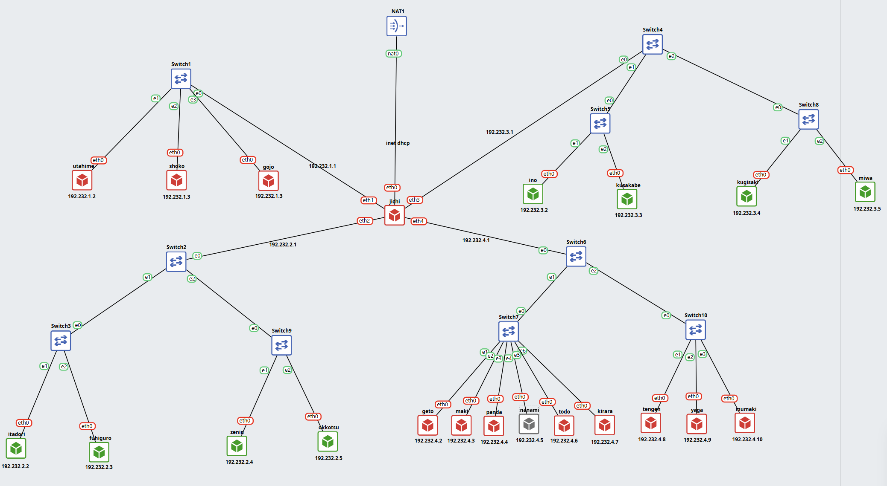

# Setup node terlebih dulu

## Catatan

eth1 (192.232.1.1)
- utahime: 192.232.1.2
- shoko: 192.232.1.3
- gojo: 192.232.1.3

eth2 (192.232.2.1)
- itadori: 192.232.2.2
- fushiguro: 192.232.2.3
- zenin: 192.232.2.4
- okkotsu: 192.232.2.5

eth3 (192.2323.3.1)
- ino: 192.232.3.2
- kusakabe: 192.232.3.3
- kugisaki: 192.232.3.4
- miwa: 1912.232.3.5

eth4 (192.232.4.1)
- geto: 192.232.4.2
- maki: 192.232.4.3
- panda: 192.232.4.4
- nanami: 192.232.4.5
- todo: 192.232.4.6
- kirara: 192.232.4.7
- tengen: 192.232.4.8
- yaga: 192.232.4.9
- inumaki: 192.232.4.10
