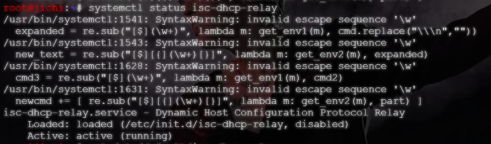
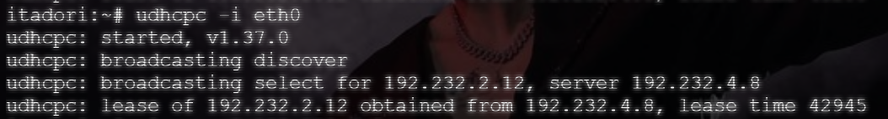
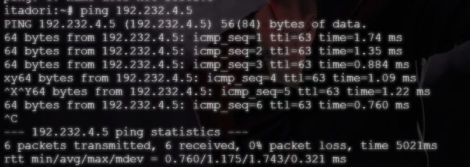

# Langkah-langkah

## Penjelasan Awal

### jichi

Pada `jichi`, lakukan instalasi `isc-dhcp-relay -y` untuk menjalankan soal 2.

Ubah isi file `/etc/default/isc-dhcp-relay` menjadi:

```bash
SERVERS="192.232.4.8"
INTERFACES="eth2 eth3 eth4"
OPTIONS=""
```

Kemudian nyalakan layanan DHCP-nya.

### tengen

Lakukan hal yang sama pada `tengen`, instalasi `apt-get install -y isc-dhcp-server` dan ubah configurasinya, kemudian nyalakan.

```bash
# Deklarasi subnet lokal Network 4
subnet 192.232.4.0 netmask 255.255.255.0 {
}

# Scope DHCP untuk Network 2
subnet 192.232.2.0 netmask 255.255.255.0 {
    range 192.232.2.10 192.232.2.50;
    option routers 192.232.2.1;
    option domain-name-servers 192.232.1.2, 8.8.8.8;
}

# Scope DHCP untuk Network 3
subnet 192.232.3.0 netmask 255.255.255.0 {
    range 192.232.3.10 192.232.3.50;
    option routers 192.232.3.1;
    option domain-name-servers 192.232.1.2, 8.8.8.8;
}
```

## Set Up

Untuk menjalankan nomor 2, jalankan script yang telah dibuat.

- `soal02_jichi.sh` pada node `jichi`
- `soal02_tengen.sh` pada node `tengen`

## Hasil




Dari tangkapan gambar diatas, dapat dilihat bahwa ketika *service* DHCP setelah di-restart, salah satu client, `Itadori` berhasil mendapatkan alamat IP-nya.

Dilakukan pengecekan pula bahwa node `Itadori` berhasil melakukan ping.

