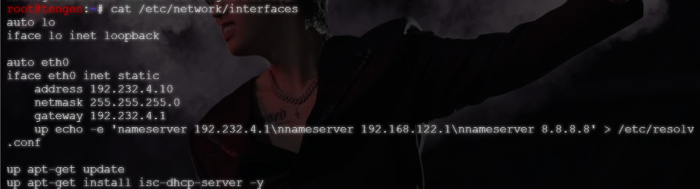
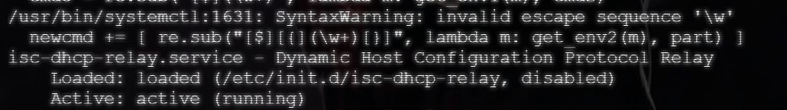
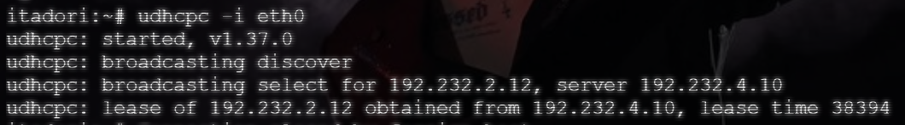

# Langkah-langkah

## Penjelasan Awal

Pada soal ini, diminta untuk mengkonfigurasikan `jichi` sebagai DHCP Relay menuju Tengen dengan IP `192.232.4.10` menggunakan eth2 dan eth3.

### Tengen

Pada node `tengen`, masuk ke `/etc/network/interfaces` dan ubah address nya menjadi `192.232.4.10`. Pastikan gateawaynya masih `192.232.4.1`.

Setelahnya, restart ulang dhcp. Pastikan server running.

```bash
systemctl restart isc-dhcp-server
systemctl enable isc-dhcp-server
systemctl status isc-dhcp-server
```

### Jichi

Ubah isi `/etc/default/isc/dhcp/relay` di bagian SERVERS menjadi `SERVERS="192.232.4.10".

## Set Up

Untuk menjalankan nomor 3, jalankan script yang telah dibuat.

- `soal03_jichi.sh` pada node `jichi`

## Hasil




Dari gambar diatas, setelah dilakukan perubahan IP Address pada `Tengen`, DHCP di-restart dan dipastikan sudah dalam kondisi AKTIVE (RUNNING).

Setelah berhasil, dilakukan pengujian terhadap client.



Dari uji coba tersebut, dapat dipastikan bahwa client berhasil mendapatkan *lease* melalui relay.
