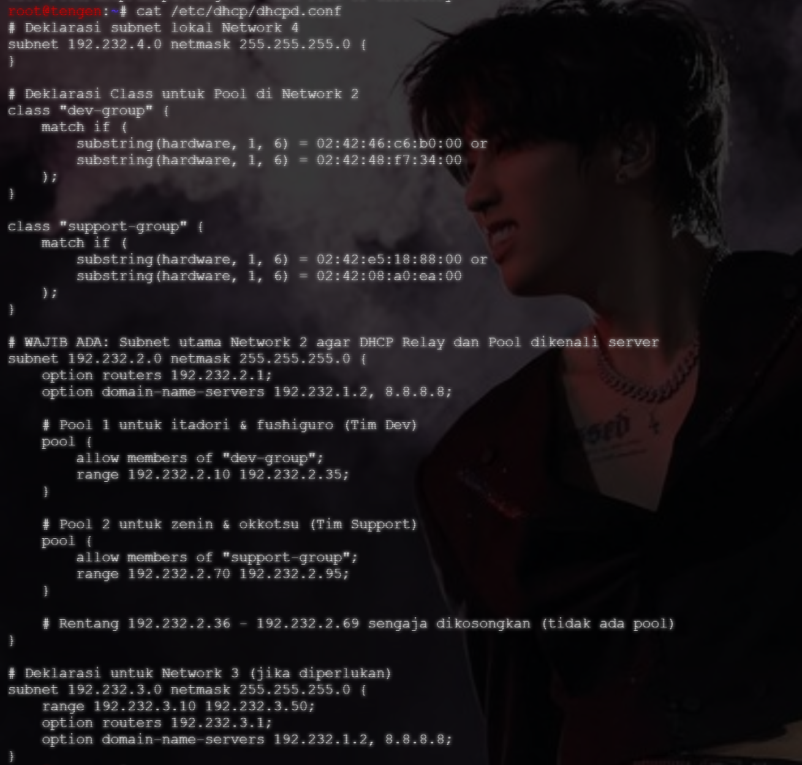
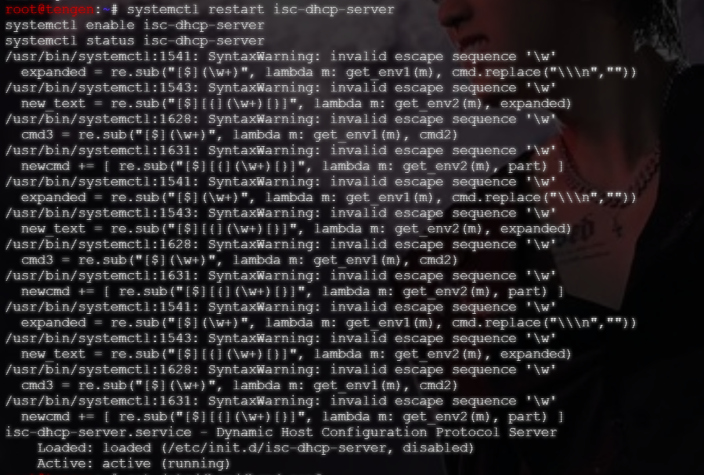
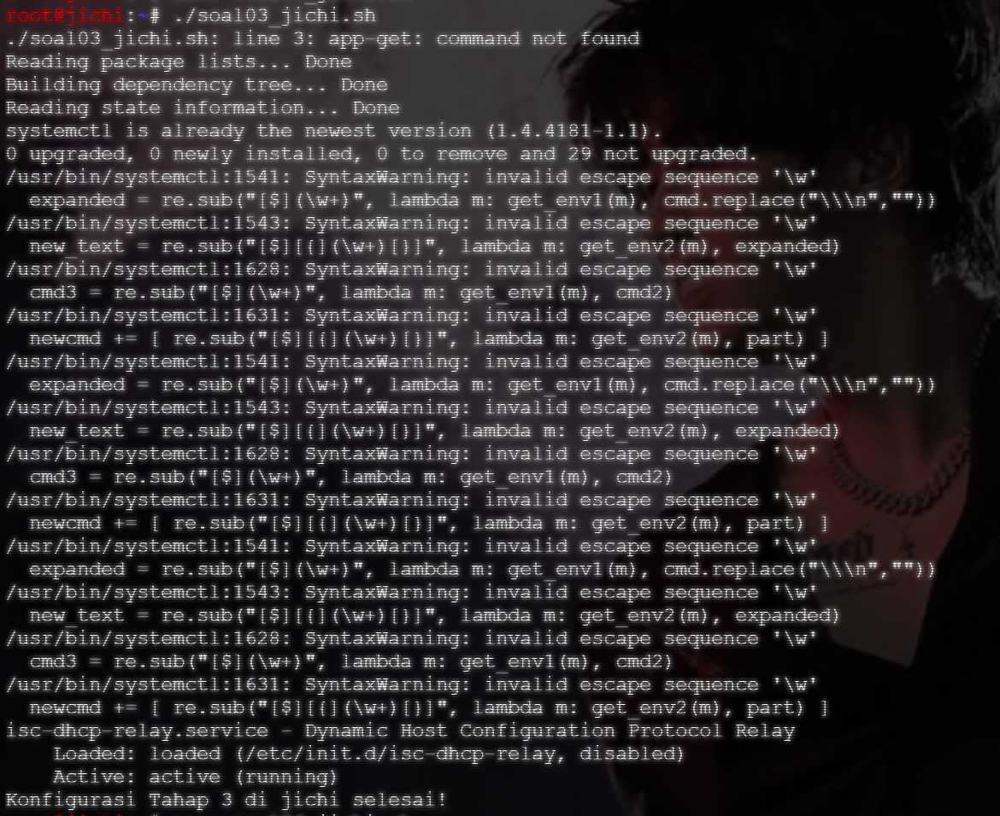
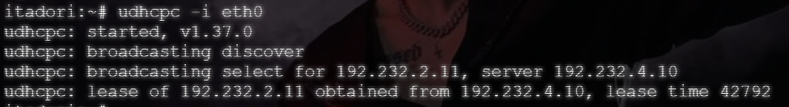
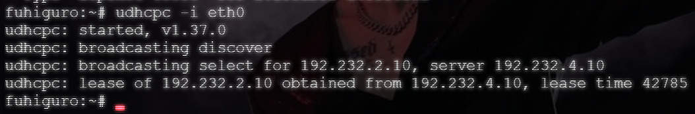
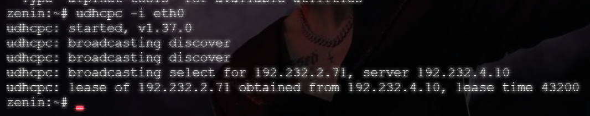
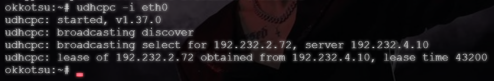

# Langkah-Langkah

## Penjelasan Awal

Pada soal ini, diminta untuk menetapkan Pool 1 (Tim Dev) untuk `itadori` dan `fushiguro`, sementara Pool 2 (Support) untuk `zenin` dan `okkotsu`. Ini dilakukan dengan catatan bahwa IP `192.232.2.36` - `192.232.2.69` tidak boleh dialokasikan.

### Tengen

Masukkan alamat MAC ke `/etc/dhcp/dhcpd.conf` dari masing-masing node di Network 2, yakni `itadori`, `fushiguro`, `zenin`, dan `okkotsu`.

```bash
ip a
```

Gunakan perintah di atas untuk melakukan pengecekan MAC di masing-masing node.

Dari perintah tersebut, didapat alamat MAC sebagai berikut:

*(Data dari alamat MAC dapat berubah!)*

- itadori

```bash
02:42:46:c6:b0:00
```

- fushiguro

```bash
02:42:48:f7:34:00
```

- zenin

```bash
02:42:e5:18:88:00
```

- okkotsu

```bash
02:42:08:a0:ea:00
```

### Jichi

Pada node `jichi`, pastikan dhcp sudah running dengan tanda ACTIVE.

## Set Up

Untuk menjalankan soal 4, jalankan script pada masing-masing node. 

- `soal04_jichi.sh` pada `jichi`
- `soal04_tengen.sh` pada `tengen`

## Hasil



Pada file `dhcpd.conf` diatas, dapat dilihat bahwa MAC sudah sesuai dengan MAC masing-masing dari node.




Apabila layanan DHCP dari `Tengen` dan `Itadori` sudah berstatus ACTIVE, jalankan pengujian pada seluruh client menggunakan `udhcpc`.






Dari hasil `udhcpc` diatas, dapat dilihat bahwa masing-masing client berhasil memperoleh IP Address melalui relay.
