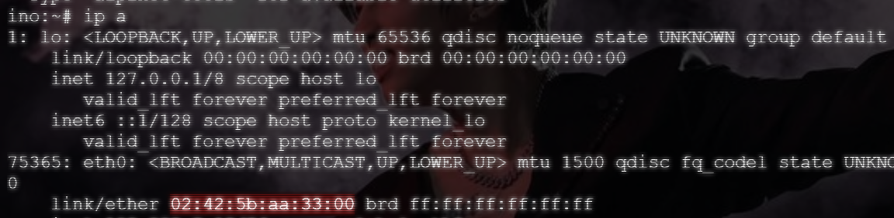
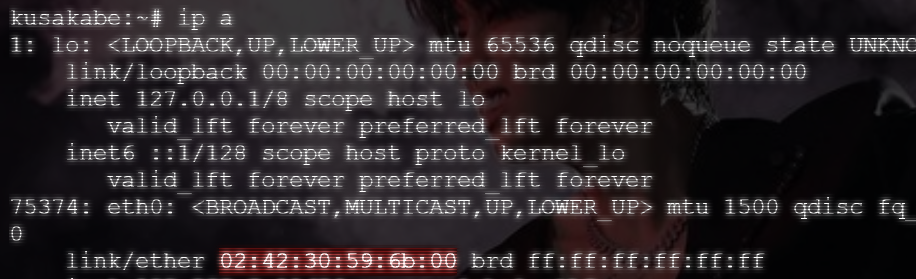
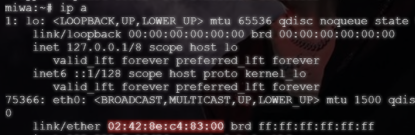
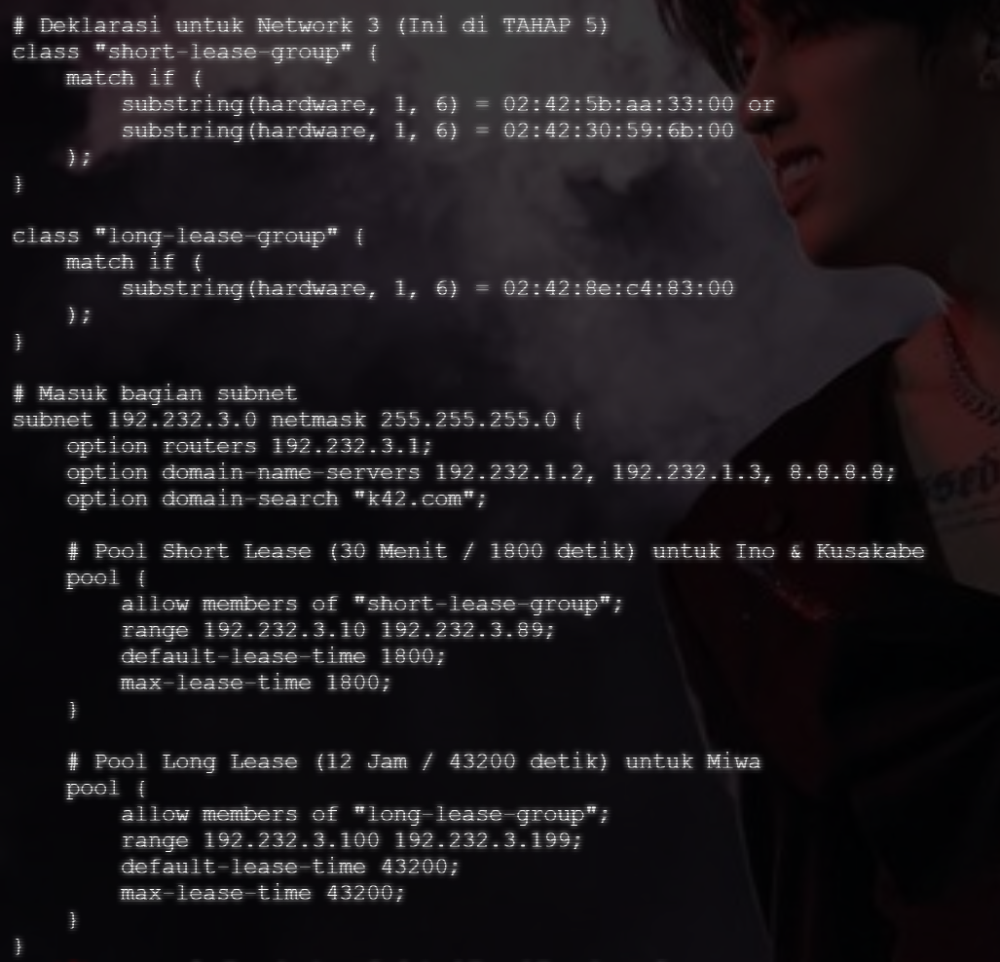
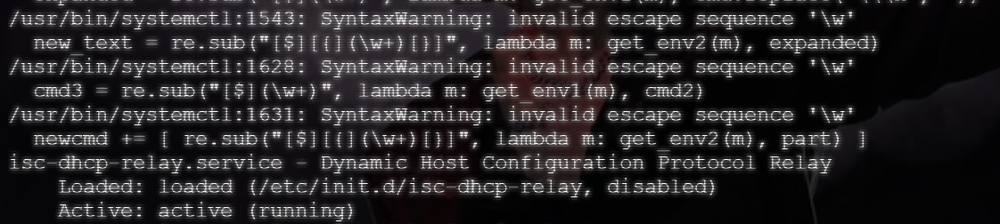
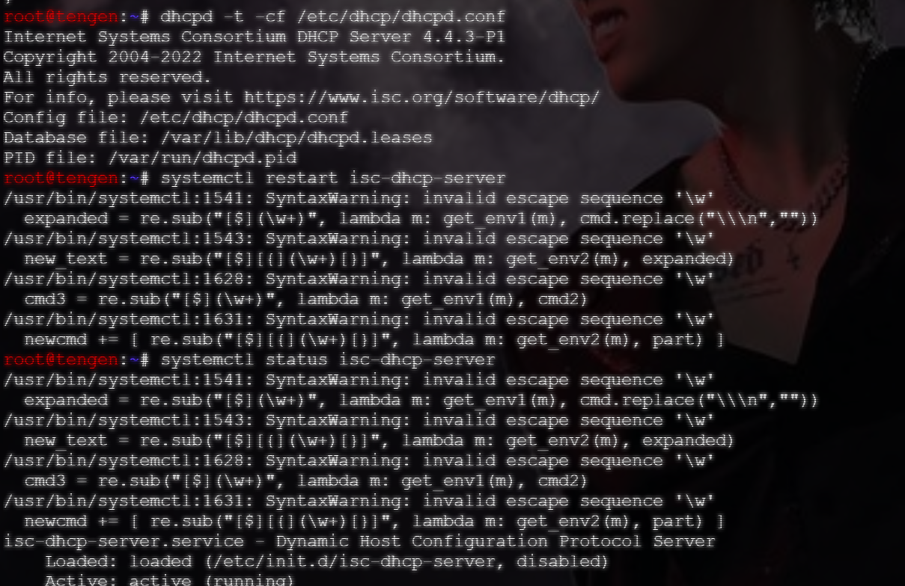
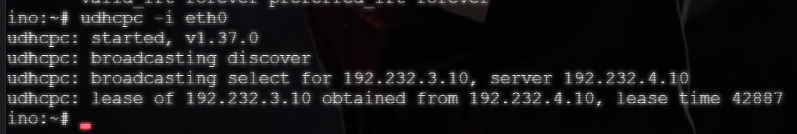
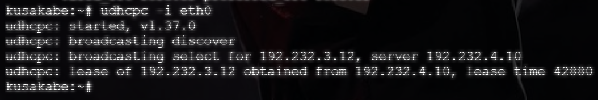
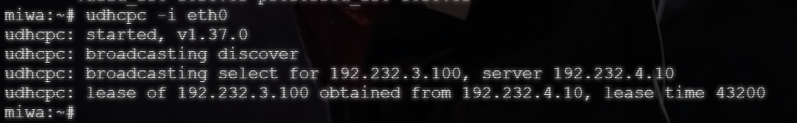

# Langkah-Langkah

## Penjelasan Awal

Pada soal ini, diminta untuk memberikan *short lease* pada `ino` dan `kusakabe`, serta *long lease* kepada `miwa`.

Perlu juga untuk memberikan DHCP options berupa `192.232.1.2`, `192.232.1.3`, dan domain-search `k42.com`.

### Jinchi

Pada node `jichi`, pastikan dhcp sudah berjalan dengan status `Active: active (running)`

```bash
systemctl restart isc-dhcp-relay
systemctl enable isc-dhcp-relay
systemctl status isc-dhcp-relay
```

### Tengen

Pada node `tengen`, masukkan alamat MAC dari semua node Network 3 (kecuali Kugisaki). Dengan `ino` dan `kusakabe` diberikan *short lease* dan `miwa` diberikan *long lease*. Ambil alamat MAC dengan menggunakan `ip a`.

```bash
ip a
```

- **Ino**

```bash
02:42:5b:aa:33:00
```



- **Kusakabe**

```bash
02:42:30:59:6b:00
```



- **Miwa**

```bash
02:42:8e:c4:83:00
```



## Set Up

Untuk menjalankan soal 5, jalankan script pada node `tengen` saja.

- `soal05_tengen.sh` pada `tengen`

## Hasil





Dari file `dhcpd.conf` diatas, dapat dilihat bahwa semua persyaratan yang diminta sudah sesuai. Setelah *restart* DHCP berhasil, dilakukan pengujian terhadap client.




