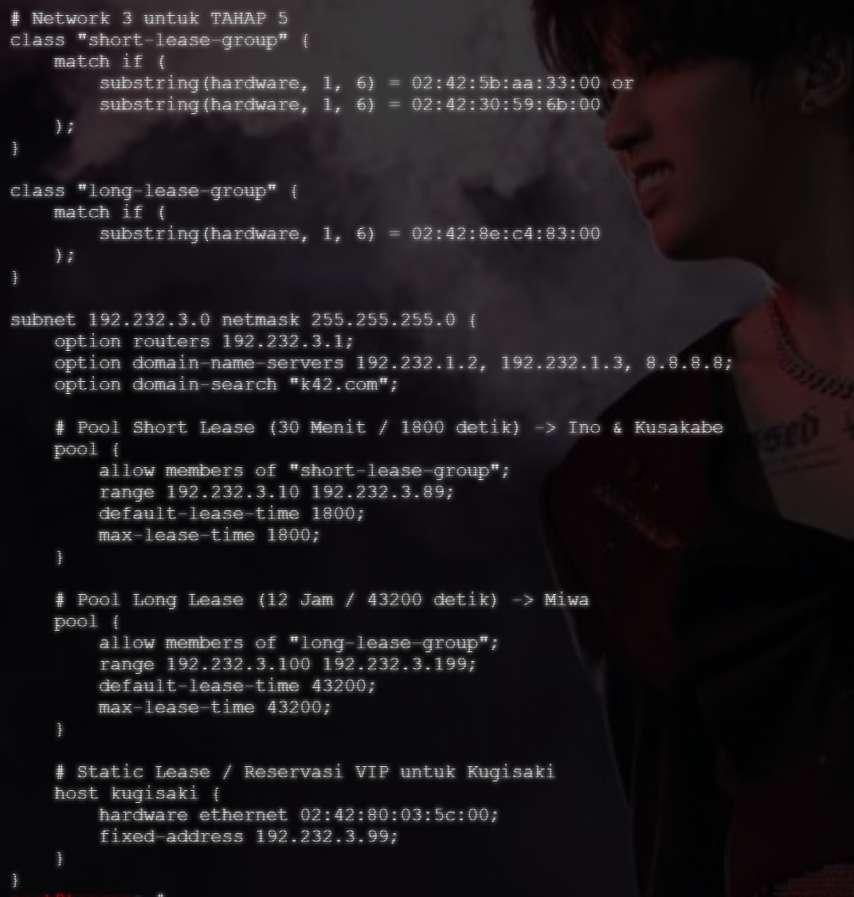
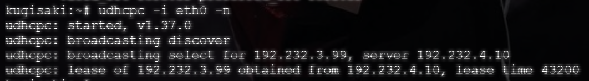

# Langkah-Langkah

## Penjelasan Awal

Pada soal ini diminta untuk menetapkan *fixed address* `192.232.3.99` untuk client `Kugisaki`.

### Jichi

Pada node `jichi` tidak perlu melakukan perubahan apapun. Cukup pastikan DHCP berjalan dengan status AKTIVE (RUNNING).

### Tengen

Pada node `tengen`, masukkan alamat MAC `kugisaki` dan set untuk *static lease* nya.

```bash
# Static Lease / Reservasi VIP untuk Kugisaki
    host kugisaki {
        hardware ethernet 02:42:80:03:5c:00;
        fixed-address 192.232.3.99;
```

Pastikan letak *static lease*-nya berada dibawah *long lease*.



## Set Up

Pada soal 6 tdiak perlu running script, cukup nyalakan DHCP dan restart dari node `tengen` dan `jichi`.

- jichi

```bash
systemctl restart isc-dhcp-relay
systemctl enable isc-dhcp-relay
systemctl status isc-dhcp-relay
```

- tengen

```bash
systemctl restart isc-dhcp-server
systemctl enable isc-dhcp-server
systemctl status isc-dhcp-server
```

## Hasil

Setelah berhasil melakukan *restart* pada DHCP Relay dan DHCP Server tanpa error, lakukan uji coba pada client `Kugisaki`.



Dari hasil `udhcpc` yang dilakukan pada `Kugisaki`, dapat dilihat bahwa node client berhasil menerima IP Address statis.