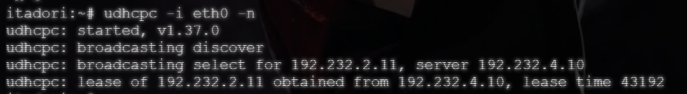
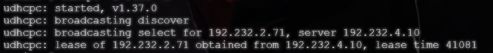
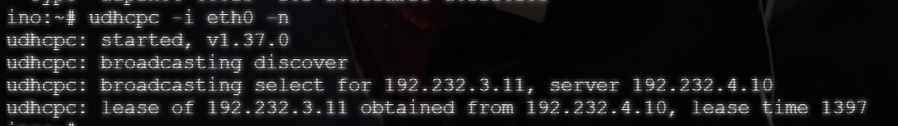
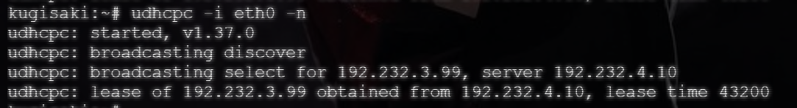
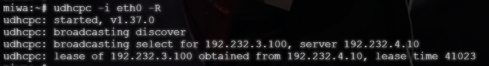

# Langkah-Langkah

## Penjelasan Awal

### Jichi

Pada node `jichi` sama seperti sebelumnya, tidak ada set-up sama sekali, namun cukup memastikan bahwa DHCP berada dalam status ACTIVE (RUNNING).

```bash
systemctl restart isc-dhcp-relay
systemctl enable isc-dhcp-relay
systemctl status isc-dhcp-relay
```

### Tengen

Pada node `tengen` juga tidak perlu melakukan perubahan yang besar. Namun pastikan alamat MAC dari node yang ada pada `/etc/dhcp/dhcpd.conf` masih sama dengan alamat MAC pada masing-masing node.

```bash
systemctl restart isc-dhcp-server
systemctl enable isc-dhcp-server
systemctl status isc-dhcp-server
```

```bash
ip a
```

Gunakan perintah diatas untuk melakukan pengecekan pada masing-masing node.

## Hasil

Lakukan pengujian terhadap perwakilan dari masing-masing grup. Pastikan IP yang dihasilkan sesuai dengan yang diminta. (lihat soal-soal sebelummnya)

- itadori (`192.232.2.10` - `192.232.2.35`)


- zenin (`192.232.2.70` - `192.232.2.95`)


- ino (`192.232.3.10` - `192.232.3.89`)


- kugisaki (`192.232.3.99`)


- miwa (`192.232.3.100` - `192.232.3.199`)

