# Langkah-Langkah

## Persiapan Awal

### Jichi dan Tengen

Tidak ada persiapan yang spesifik, cukup melakukan restart terhadap dhcp yang ada, dan pada `tengen`, pastikan alamat MAC sudah sesuai dengan masing-masing node yang akan di uji.

- Jichi

```bash
systemctl restart isc-dhcp-relay
systemctl enable isc-dhcp-relay
systemctl status isc-dhcp-relay
```

- Tengen

```bash
systemctl restart isc-dhcp-server
systemctl enable isc-dhcp-server
systemctl status isc-dhcp-server
```

Cek alamat MAC:

```bash
cat /etc/dhcp/dhcpd.conf
nano /etc/dhcp/dhcpd.conf
```

## Set Up

Tidak ada script yang harus dijalankan. Namun cukup jalankan `tcpdump` untuk melakukan pengecekan `DHCPDISCOVER` `DHCPOFFER` `DHCPREQUEST` `DHCPACK`

```bash
tcpdump -i eth0 -vvv -nn port 67 or port 68
```

## Hasil

### Itadori

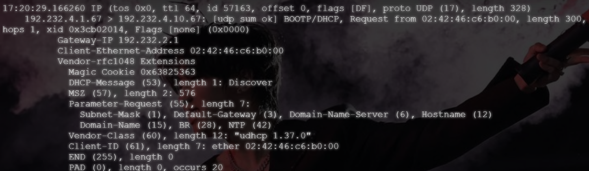
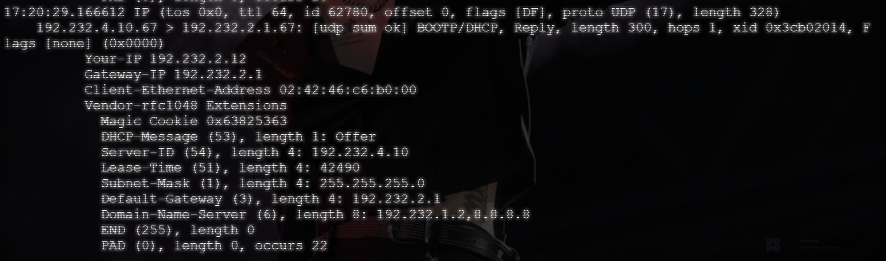
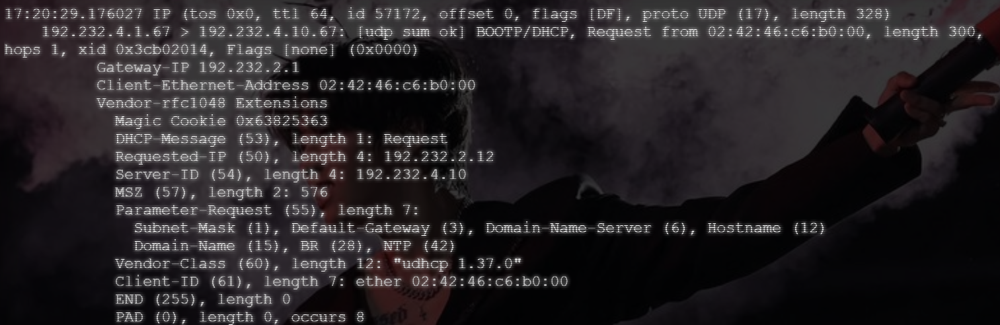
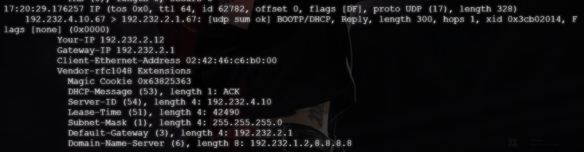

Dari hasil tangkapan diatas, di dapatkan detail parameter jaringannya:

- Alamat server: `192.232.4.10`
- Alamat yang diberikan: `192.232.2.12`
- Lease time: `42490`
- Field giaddr: `192.232.2.1`

### Zenin

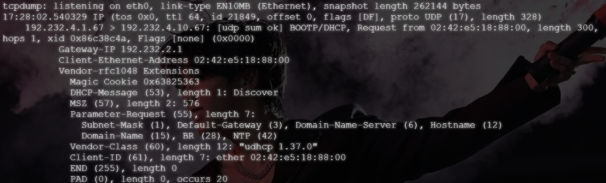
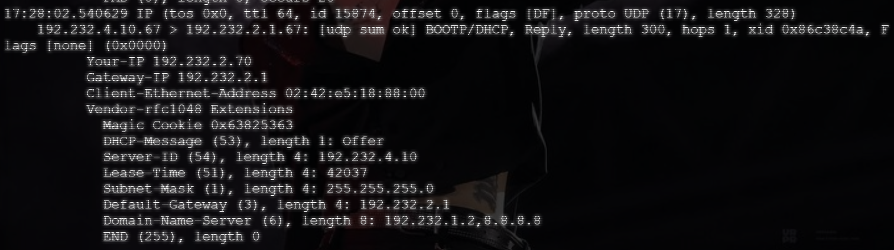

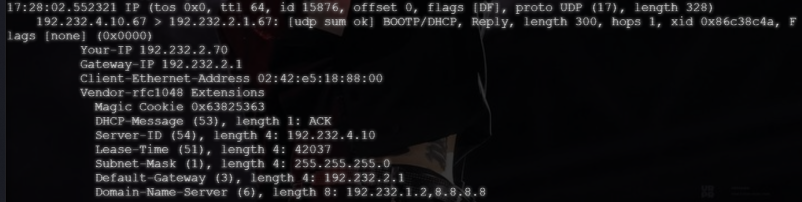

Dari hasil tangkapan diatas, di dapatkan detail parameter jaringannya:

- Alamat server: `192.232.4.10`
- Alamat yang diberikan: `192.232.2.70`
- Lease time: `42037`
- Field giaddr: `192.232.2.1`

### Ino

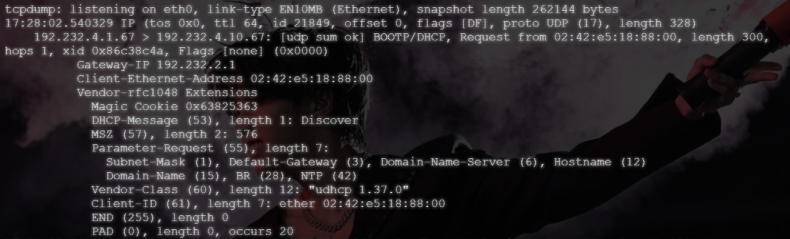
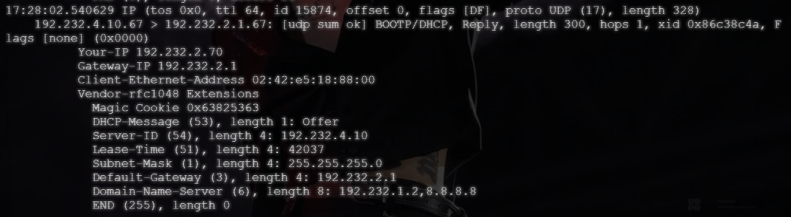
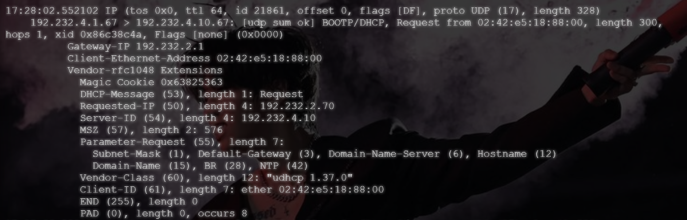
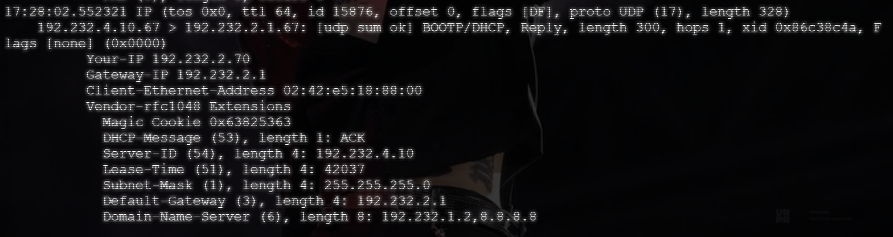

Dari hasil tangkapan diatas, di dapatkan detail parameter jaringannya:

- Alamat server: `192.232.4.10`
- Alamat yang diberikan: `192.232.3.11`
- Lease time: `41941`
- Field giaddr: `192.232.3.1`

### Miwa

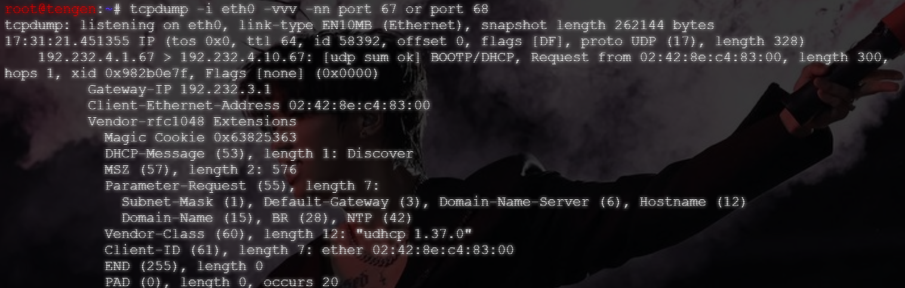
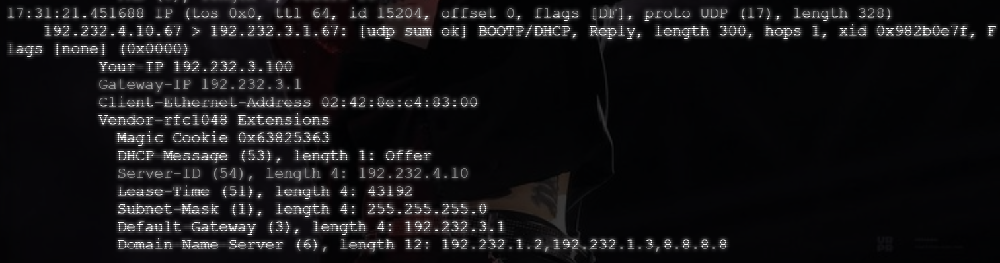
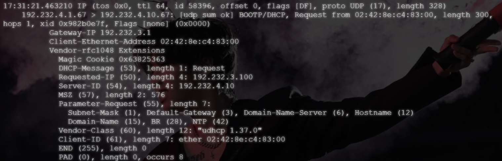
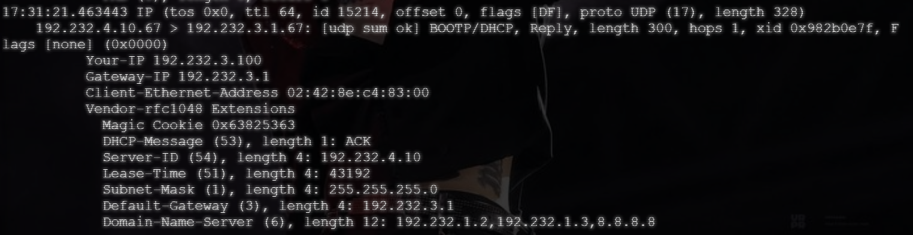

Dari hasil tangkapan diatas, di dapatkan detail parameter jaringannya:

- Alamat server: `192.232.4.10`
- Alamat yang diberikan: `192.232.3.100`
- Lease time: `43192`
- Field giaddr: `192.232.3.1`

### Kugisaki

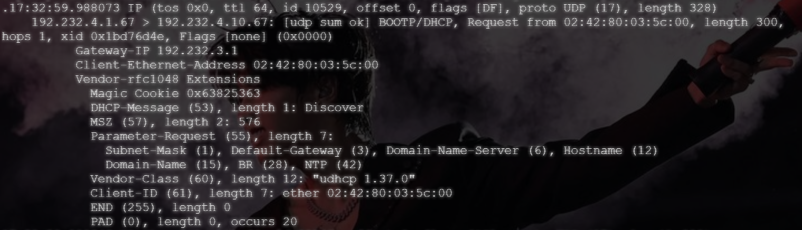
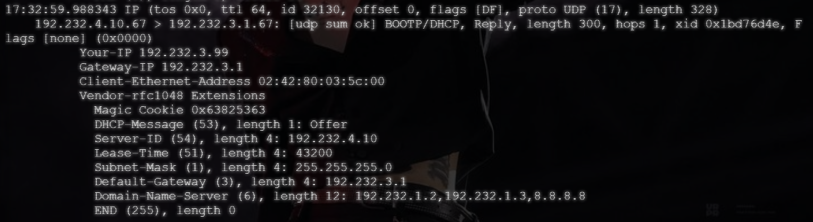
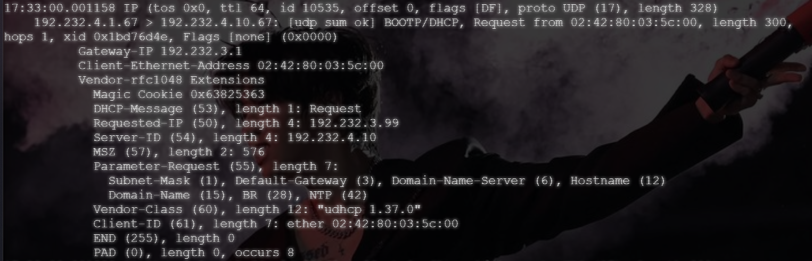
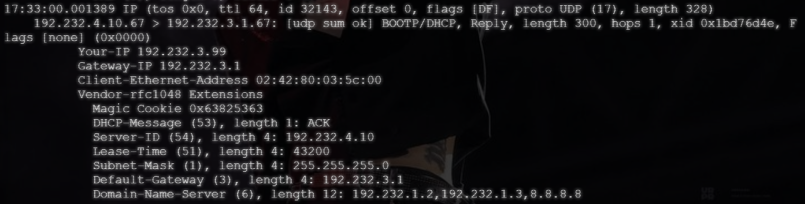

Dari hasil tangkapan diatas, di dapatkan detail parameter jaringannya:

- Alamat server: `192.232.4.10`
- Alamat yang diberikan: `192.232.3.99`
- Lease time: `43200`
- Field giaddr: `192.232.3.1`