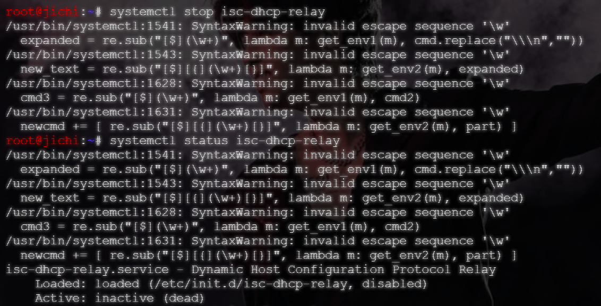
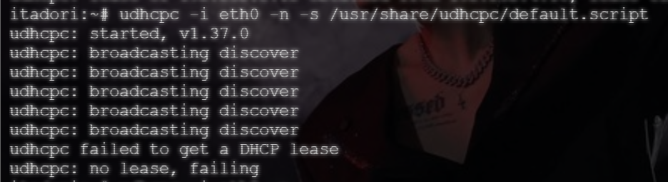
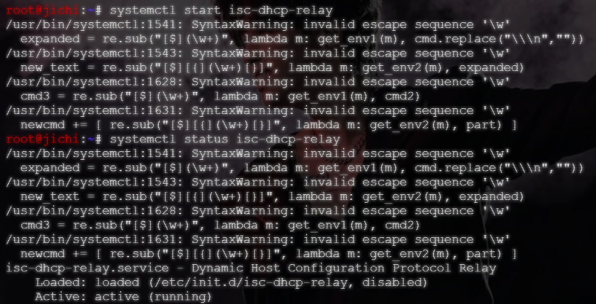
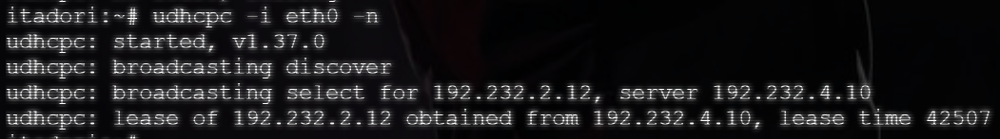

# Langkah-Langkah

## Penjelasan Awal

Pada soal 9, diminta untuk melakukan pengujian untuk request permintaan alamat IP apabila DHCP dimatikan.

Tidak ada persiapan yang spesifik untuk penyelesaian nomor ini. Cukup pastikan DHCP dalam keadaan aktif sebelum pengujian dilakukan.

- Jichi

```bash
systemctl restart isc-dhcp-relay
systemctl enable isc-dhcp-relay
systemctl status isc-dhcp-relay
```

- Tengen

```bash
systemctl restart isc-dhcp-server
systemctl enable isc-dhcp-server
systemctl status isc-dhcp-server
```

## Set Up

Pada soal ini tidak ada script yang harus dijalankan. Hanya berupa perintah yang dijalankan di terminal secara langsung.

Matikan DHCP dari node `jichi` untuk melakukan pengujian.

```bash
systemctl stop isc-dhcp-server
```

Kemudian pindah ke node client, `itadori`. Minta alamat IP secara paksa.

```bash
udhcpc -i eth0 -n -s /usr/share/udhcpc/default.script
```

Selanjutnya, nyalakan kembali DHCP, dan minta alamat IP dengan cara normal.

```bash
# Jalankan di JICHI
systemctl start isc-dhcp-relay
systemctl status isc-dhcp-relay

# Jalankan di ITADORI
udhcpc -i eth0 -n
```

## Hasil

Dari uji coba yang telah dijalnkan, ketika `itadori` (client) meminta secara paksa dengan kondisi DHCP sedang dimatikan, tidak akan ada balasan yang datang.




Output `udhcpc: broadcasting discover` menunjukkan bahwa tidak ada balasan yang datang dari `jichi`. Hal ini dikarenakan service DHCP pada `jichi` telah dimatikan, sehingga paket broadcast `DISCOVER` dari *client* hanya akan berputar di subnet lokal saja.




Setelah service DHCP dinyalakan, `itadori` mendapatkan output `udhcpd: broadcasting select`. Ini menandaan bahwa *client* berhasil mendapatkan balasan dari DHCP (`jichi`). Hal ini dikarenakan pulihnya perantara komunikasi antar subnet.