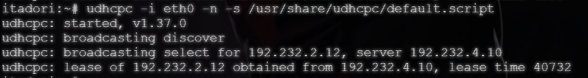
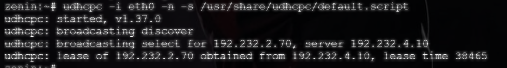
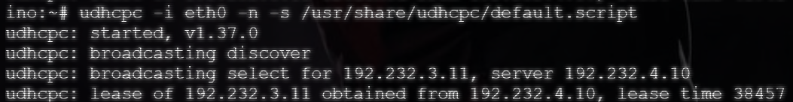
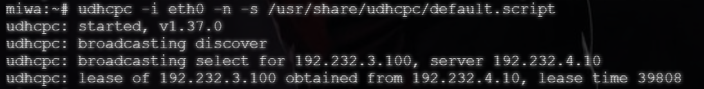
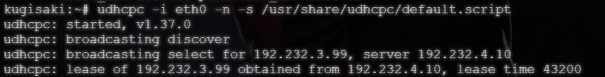

# Langkah-Langkah

## Penjelasan Awal

Pada soal ini diminta untuk memastikan DHCP Server dan DHCPP Jichi telah mengaktifkan `autostart`. Hal ini bertujuan agar seluruh layanan pendukung akan langsung aktif secara otomatis ketika server dihidupkan ulang. 

## Tengen

Pada node `Tengen` tidak perlu melakukan persiapan yang terlalu rumit. Cukup pastikan server DHCP telah menyala.

```bash
# Untuk melakukan pengecekan
systemctl status isc-dhcp-server
```

## Jichi

Pada node `Jichi` tidak perlu melakukan persiapan yang terlalu rumit. Cukup pastikan server DHCP telah menyala.

```bash
# Untuk melakukan pengecekan
systemctl status isc-dhcp-relay
```

## Set Up

Tidak ada script yang harus dijalankan. Cukup jalankan perintah pada terminal saja.

Jalankan perintah `enable` pada kedua node agar dapat menyalakan autostart yang diminta pada soal.

```bash
# Pada TENGEN
systemctl enable isc-dhcp-server
systemctl restart isc-dhcp-server
systemctl status isc-dhcp-server

# Pada JICHI
systemctl enable isc-dhcp-relay
systemctl restart isc-dhcp-relay
systemctl status isc-dhcp-relay
```

## Hasil

Setelah node berhasil dilakukan`enable` dan `restart`,  lakukan pengecekan pada masing-masing client.





