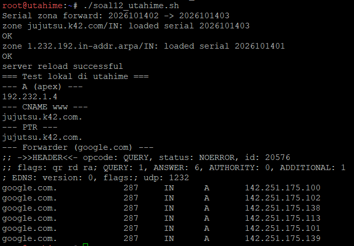
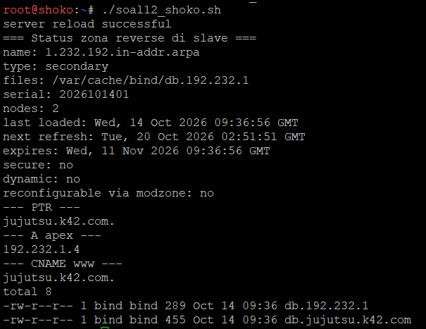
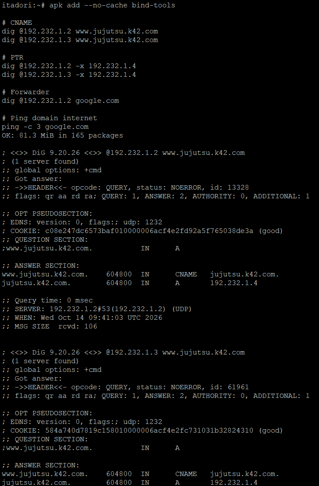
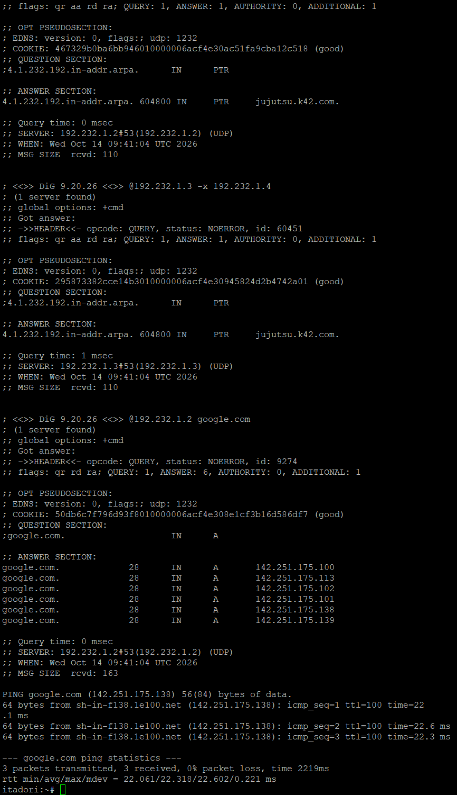

# Langkah-Langkah

## Penjelasan Awal
Kita diperlukan untuk menambahkan record yang mengarah ke node gojo (sudah pada nomor sebelumnya), serta CNAME yang merujuk ke domain utama tersebut. Lalu kita membuat reverse dns (zona ptr) untuk melacak IP gojo kembali ke domain resminya. Terakhir kita uji dari client dengan dig.

### Utahime
Jalankan script `soal12_utahime.sh`


Disini terlihat bahwa verifikasi yang berada di dalam scriptnya menghasilkan jawaban yang benar dan berhasil mengupdate dan membuat reverse dnsnya serta menaikkan forwardernya (google).

### Shoko
Jalankan script `soal12_shoko.sh`


Disini terlihat jika slave berhasil menarik dari master.

### Validasi
Untuk melakukan validasi, kita uji coba di node itadori.
```
apk add --no-cache bind-tools

# CNAME
dig @192.232.1.2 www.jujutsu.k42.com
dig @192.232.1.3 www.jujutsu.k42.com

# PTR
dig @192.232.1.2 -x 192.232.1.4
dig @192.232.1.3 -x 192.232.1.4

# Forwarder
dig @192.232.1.2 google.com

# Ping domain internet
ping -c 3 google.com
```




Kita bisa melihat bahwa dignya menghasilkan CNAME, PTR jujutsu.k42.com, dan dig google.com menghasilkan no error dan berhasil di ping.

Dengan itu, soal 12 sudah selesai.