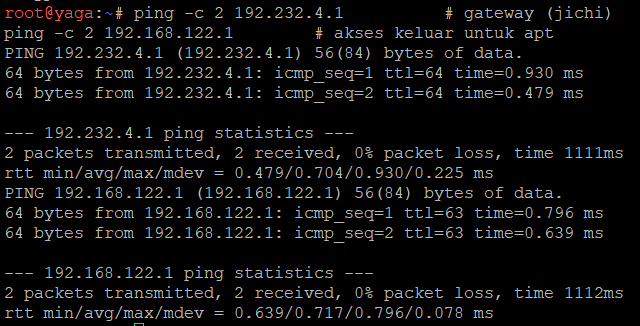
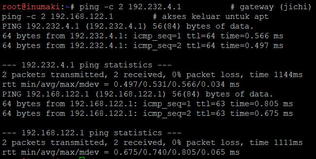
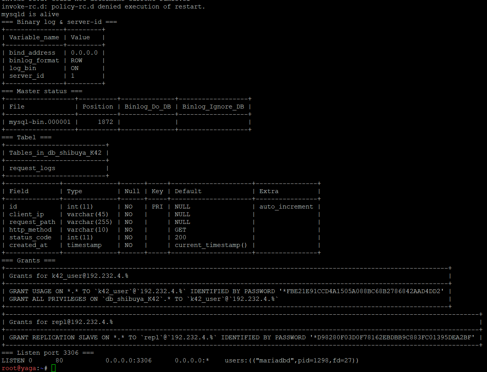
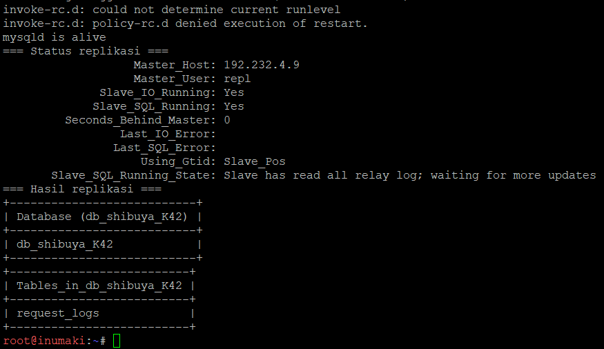
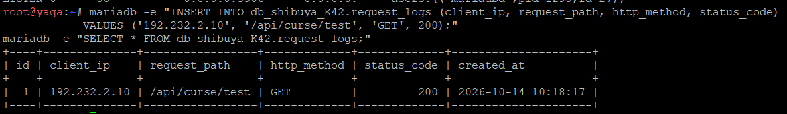
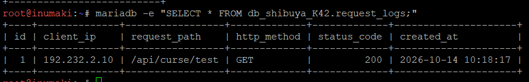
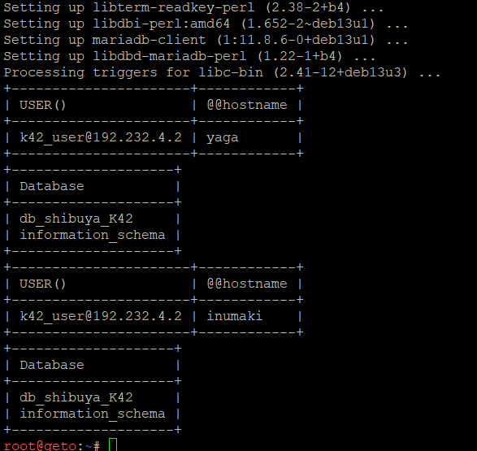
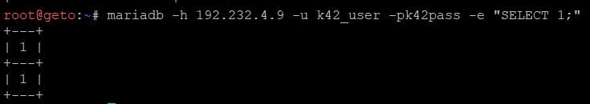

# Langkah-Langkah

## Penjelasan Awal
Nomor ini mirip seperti nomor 11, bedanya kita membuat DB menggunakan MariaDB pada node yaga sebagai DB-Master dan inumaki sebagai DB-Slave. Kita disuruh untuk membuat database db_shibuya_k42 beserta tabel request_logs di master, lalu aktifkan binary logging. Setelah itu inumaki sebagai slave harus bisa menyalin data secara realtime dengan CHANGE MASTER TO. Kita juga perlu untuk memberikan hak akses remote bagi seluruh node di network 4 dan melakukan pembuktian slave.

### Pendahuluan
Kita pertama mengecek konektivitas di yaga dan inumaki terlebih dahulu.
```
ping -c 2 192.232.4.1          # gateway (jichi)
ping -c 2 192.168.122.1        # akses keluar untuk apt
```




Disini terlihat bahwa ping berhasil, maka kita mulai pengerjaannya.

### Yaga
Jalankan script `soal13_yaga.sh`.


Disini kita bisa melihat tabel request_logs yang berhasil dibuat dan port 3306 yang listen di 0.0.0.0.

### Inumaki
Jalankan script `soal13_inumaki.sh`


Disini kita bisa melihat kedua statusnya mengembalikan YES serta database dan tabel yang sudah muncul di slave.

### Validasi
Untuk mengetes apakah replikasi berjalan secara realtime, kita lakukan berikut.

Di Yaga:
```
mariadb -e "INSERT INTO db_shibuya_K42.request_logs (client_ip, request_path, http_method, status_code)
            VALUES ('192.232.2.10', '/api/curse/test', 'GET', 200);"
mariadb -e "SELECT * FROM db_shibuya_K42.request_logs;"
```

Di Inumaki
```
mariadb -e "SELECT * FROM db_shibuya_K42.request_logs;"
```




Disini terlihat bahwa Inumaki berhasil untuk melakukan replikasi secara realtime yang bisa dilihat lewat pembuatan baris baru di tabel request_logs lewat Yaga yang berhasil di replikasi oleh Inumaki.

Lalu kita melakukan pembuktian hak akses remote Network 4.

Pada Geto (Tidak harus Geto, asalkan nodenya berada pada remote network 4.):
```
apt-get update && apt-get install -y mariadb-client
mariadb -h 192.232.4.9  -u k42_user -pk42pass -e "SELECT USER(), @@hostname; SHOW DATABASES;"
mariadb -h 192.232.4.10 -u k42_user -pk42pass -e "SELECT USER(), @@hostname; SHOW DATABASES;"

# Jalankan ini setelahnya
mariadb -h 192.232.4.9 -u k42_user -pk42pass -e "SELECT 1;"
```




Disini kita bisa melihat bahwa kita bisa melihat databasenya dan login sukses dari node Network 4 ke Master dan Slave.

Dengan ini, soal 13 sudah selesai.