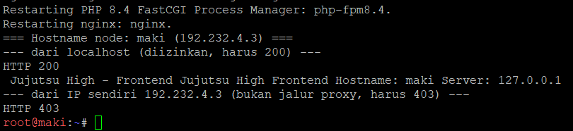
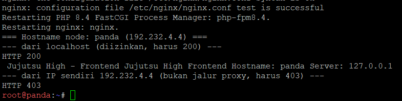
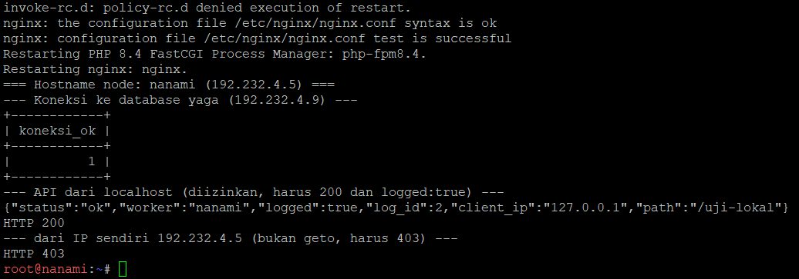
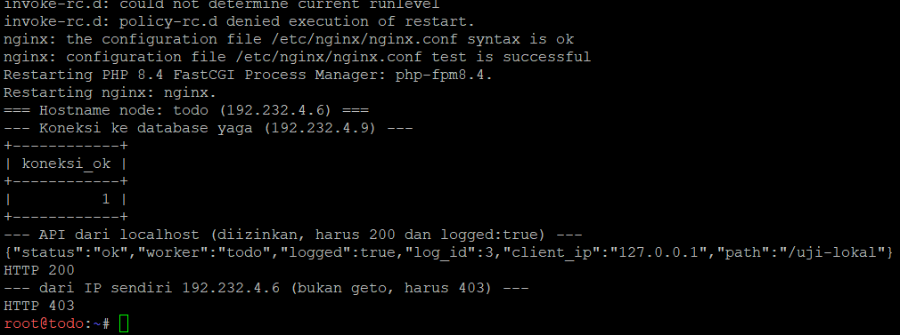
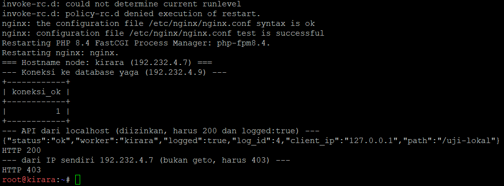
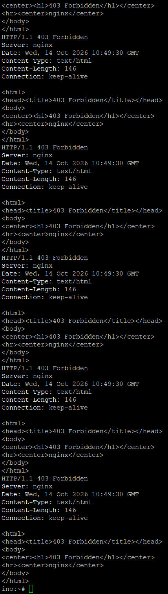
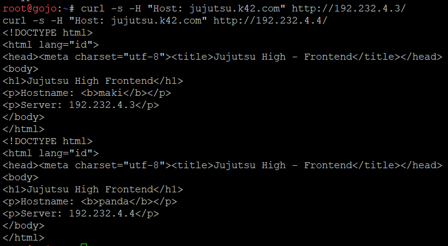
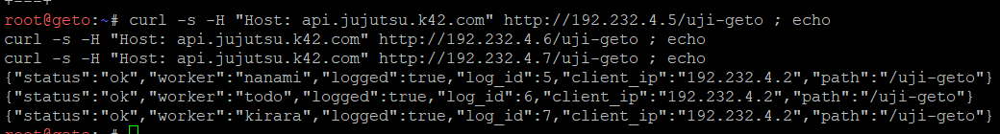

# Langkah-Langkah

## Penjelasan Awal
Pada soal ini kita diperlukan untuk pasang Nginx dan PHP-FPM pada maki dan panda untuk menyajikan web frontend yang menampilkan hostname masing-masing. Pada nanami, todo, dan kirara, siapkan layanan API yang mencatat log request ke database yaga. Konfigurasikan virtual host agar worker merespons domain layanan yang ditentukan. Batasi akses langsung dari klien ke worker, web worker hanya menerima trafik melalui jalur proxy web yang ditentukan, sedangkan worker API hanya menerima trafik melalui geto.

### Node Worker Web (Maki dan Panda)
Jalankan script `soal14_makipanda.sh` di node masing-masing.




Disini terlihat bahwa script berhasil terjalan tanpa error.

### Node Worker API (Nanami, Todo, Kirara)
Jalankan script `soal14_nanamitodokirara.sh` di node masing-masing.





Disini terlihat bahwa script berhasil terjalan tanpa error.

### Verifikasi
Setelah semuanya terjalan, kita mulai untuk verifikasi akses langsung dari klien ditolak. Untuk verifikasi ini, kita menggunakan node random, misal ino.

Di Ino:
```
curl -i http://192.232.4.3/                                      # maki   -> 403
curl -i http://192.232.4.4/                                      # panda  -> 403
curl -i http://192.232.4.5/                                      # nanami -> 403
curl -i http://192.232.4.6/                                      # todo   -> 403
curl -i http://192.232.4.7/                                      # kirara -> 403
curl -i -H "Host: jujutsu.k42.com" http://192.232.4.3/           # tetap 403 meski Host benar
curl -i -H "Host: api.jujutsu.k42.com" http://192.232.4.5/       # tetap 403
```



Disini terlihat bahwa semua curl menghasilkan 403 forbidden yang berarti akses langsung dari klien ditolak berhasil.

Berikut kita coba akses lewat jalur proxy berhasil melalui node gojo (jalur web) dan geto (jalur api).

Di Gojo:
```
curl -s -H "Host: jujutsu.k42.com" http://192.232.4.3/
curl -s -H "Host: jujutsu.k42.com" http://192.232.4.4/
```



Disini terlihat bahwa gojo berhasil untuk mengecurl.

Di Geto:
```
curl -s -H "Host: api.jujutsu.k42.com" http://192.232.4.5/uji-geto ; echo
curl -s -H "Host: api.jujutsu.k42.com" http://192.232.4.6/uji-geto ; echo
curl -s -H "Host: api.jujutsu.k42.com" http://192.232.4.7/uji-geto ; echo
```



Disini terlihat bahwa geto berhasil mengecurl worker pada api webnya.

Dengan itu, soal 14 sudah selesai.