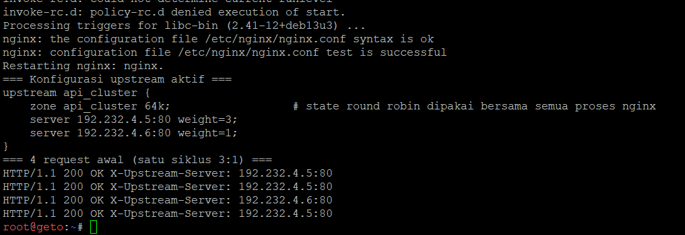
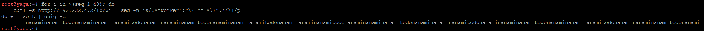
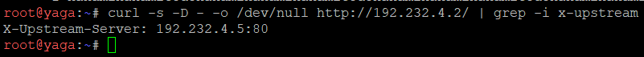
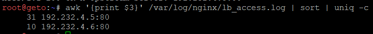

# Langkah-Langkah

## Penjelasan Awal
Pada soal ini, kita disuruh untuk mengkonfigurasikan Nginx pada geto sebagai Load Balancer internal dengan upstream api_cluster yang mengarahkan trafik ke nanami dan todo. Terapkan algoritma Weighted Round Robin dengan bobot 3:1, di mana nanami menerima porsi beban tiga kali lebih banyak daripada todo. Buktikan distribusi beban ini dengan melakukan loop request berulang kali ke geto dari jaringan lokal Data Center dan periksa rasio responnya.

### Geto
Jalankan script `soal15_geto.sh`.



Disini terlihat bahwa script berhasil berjalan. 4 Request menjawab dengan OK dan upstream aktif berjalan.

### Verifikasi
Untuk melakukan verifikasi pembuktian distribusi 3:1, kita menjalankan berikut di node selain geto, misalnya yaga.

Di Yaga:
```
for i in $(seq 1 40); do
    curl -s http://192.232.4.2/lb/$i | sed -n 's/.*"worker":"\([^"]*\)".*/\1/p'
done | sort | uniq -c

# Lihat juga header yang menunjukkan worker penjawab:
curl -s -D - -o /dev/null http://192.232.4.2/ | grep -i x-upstream
```




Disini terlihat bahwa rasio berhasil dimana nanami dan todo adalah 3:1 (nanaminanaminanamitodo).

Dan kita juga melakukan verifikasi di geto untuk bukti tambahan dari sisi geto dan worker (nanami, todo).

Di Geto:
```
awk '{print $3}' /var/log/nginx/lb_access.log | sort | uniq -c
```



Disini terlihat bahwa rasio benar 3:1 dan total adalah 40 (walaupun nanami 31, berarti total 41. Tetapi +1 ini berasal dari request lain ke geto maka tetap aman.) berserta source IP log worker.

Dengan itu, soal sudah selesai.