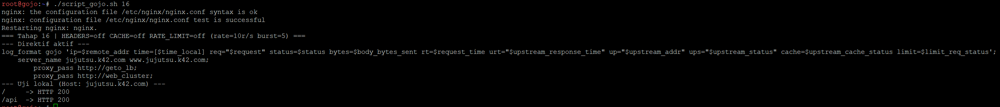
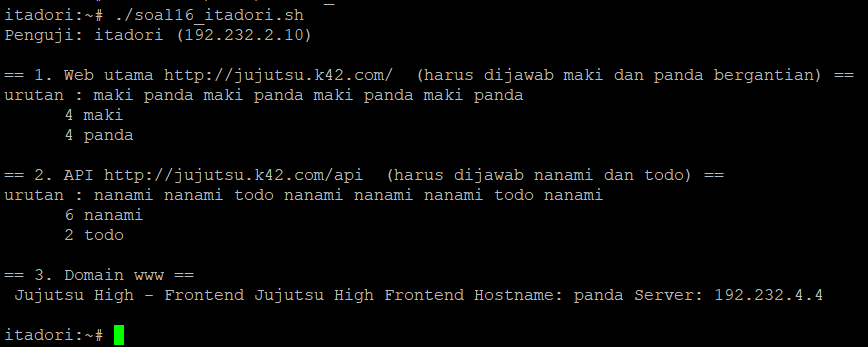
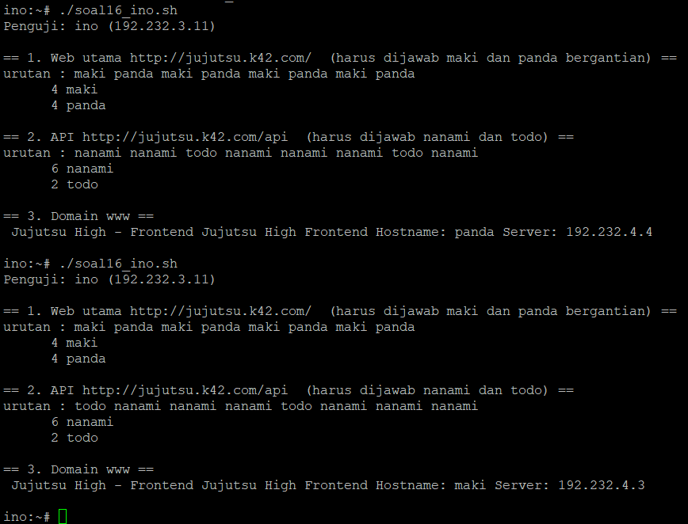

# Langkah-Langkah

## Penjelasan Awal
Kita ditugaskan untuk mengkonfigurasikan Nginx pada gojo untuk melayani domain jujutsu.<xxxx>.com dan www.jujutsu.<xxxx>.com menggunakan metode Path-Based Routing. Atur agar request root (/) diteruskan secara Round Robin ke worker frontend (maki dan panda), sedangkan request ke path /api diteruskan langsung ke geto. Uji dari client Divisi A atau B bahwa akses ke web utama dibalas oleh Maki/Panda, sedangkan akses ke /api diteruskan dan dijawab oleh Nanami/Todo.

### Gojo
Jalankan script `script_gojo.sh` untuk nomor 16 dengan menjalankan:
```
./script_gojo.sh 16
```



Disini terlihat bahwa script berhasil dijalankan dan kita bisa melihat direktif aktif dan pengujian lokal dari scriptnya yang terjalan dengan aman.

### Verifikasi
Kita melakukan verifikasi di node itadori dan ino.

Untuk melakukan verifikasi tersebut, kita jalankan script `soal16_itadori.sh` dan `soal16_ino.sh`




Disini terlihat bahwa verifikasi berhasil dimana pemanggilan akses web utama (/) dibalas oleh Maki/Panda, sedangkan akses ke /api diteruskan dan dijawab oleh Nanami/Todo sesuai dengan soal.

Dengan ini, soal 16 sudah selesai.