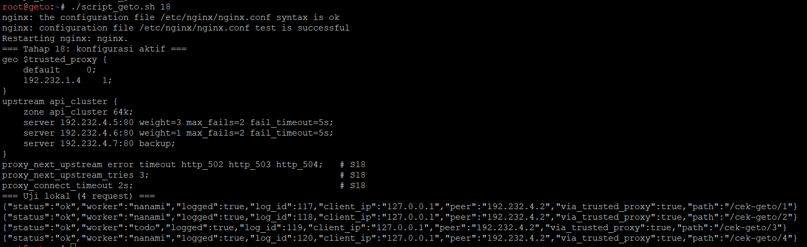
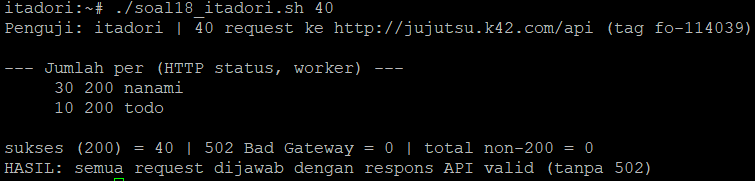
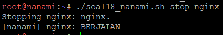
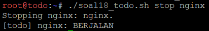
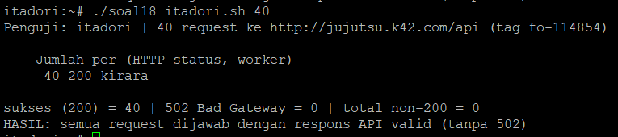
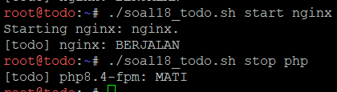
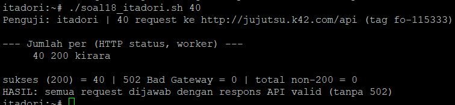
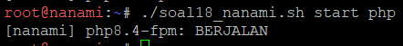
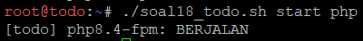
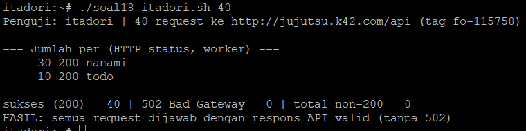

# Langkah-Langkah

## Penjelasan Awal
Pada soal ini, nanami dan todo merupakan worker API utama, sedangkan kirara disiapkan sebagai worker cadangan. Kita ditugaskan untuk mengkonfigurasikan upstream api_cluster pada geto agar kirara menjadi server backup, serta terapkan passive health check dengan parameter max_fails=2 dan fail_timeout=5s pada worker API utama. Pastikan kirara menjalankan layanan API yang kompatibel dengan endpoint utama. Simulasikan gangguan dengan menghentikan layanan Nginx atau layanan API pada nanami dan todo. Buktikan dari klien bahwa request ke /api dialihkan ke kirara dan menghasilkan respons API yang valid tanpa error 502 Bad Gateway.

### Geto
Pertama kita perlu untuk mengkonfigurasi upstream api_cluster pada geto agar kirara menjadi server backup. Maka, kita jalankan script berikut
```
./script_geto 18
```



Disini terlihat bahwa geto berhasil menambahkan ip kirara sebagai upstream api_cluster.

### Testing
Pertama, kita coba jalankan kondisi normal sebagai pembanding.

Misalnya, pada node itadori, kita jalankan script `soal18_itadori.sh` terlebih dahulu dengan:
```
./soal18_itadori.sh 40
```

Ini akan mensimulasikan itadori melakukan 40 request.



Disini terlihat kondisi normal dimana 40 request dari itadori dapat berjalan dengan normal (sukses).

Setelah itu, mari kita coba jalankan simulasi gangguan dimana kita mematikan nginx di nanami dan todo dengan menjalankan script `soal18_nanamitodo` dengan melakukan:

```
./soal18_nanamitodo.sh stop nginx
```

Untuk mensimulasikan matinya nginx.





Setelah itu, kita menjalankan script pada itadori saat nginx pada nanami dan todo sedang mati.



Disini terlihat bahwa sekarang semua request terkirim ke kirara daripada 30 ke nanami dan 10 ke todo (rasio 3:1). Ini membuktikan kirara berhasil menjadi worker cadangan.

Kita melakukan simulasi lanjut tetapi bedanya kita mematikan php pada nanami dan todo. (nginx hidup)

```
./soal18_nanamitodo.sh start nginx
./soal18_nanamitodo.sh stop php
```




Setelah php mati, kita jalankan script lagi di itadori.



Disini terlihat bahwa semua request terkirim ke kirara, yang berarti kirara berhasil lagi menjadi worker cadangan.

Terakhir kita melakukan pemulihan dengan menghidupkan lagi php pada nanami dan todo.
```
./soal18_nanamitodo.sh start php
```






Setelah pemulihan, kita coba untuk terakhir kalinya di itadori.



Disini terlihat bahwa request kembali terkirim ke nanami dan todo dengan rasio 3:1.

Dengan ini, soal 18 selesai.