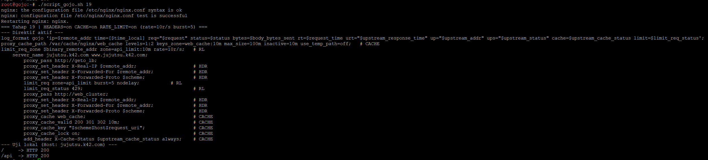
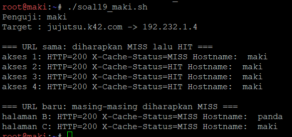
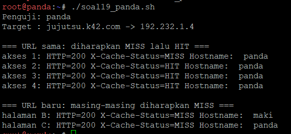
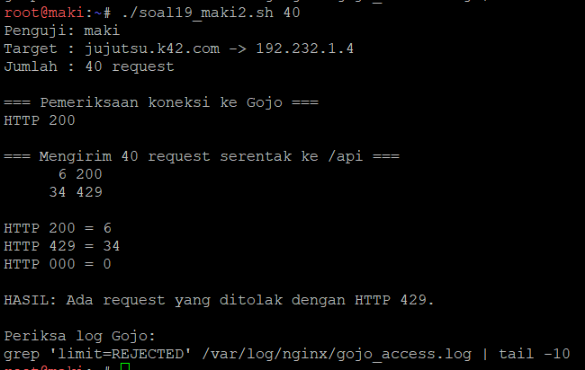
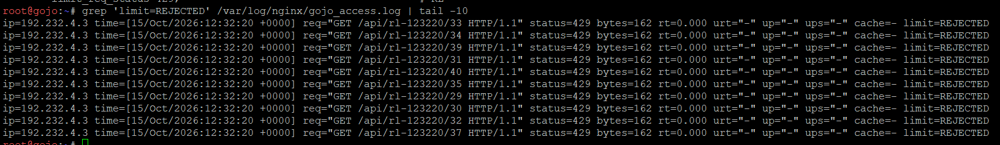

# Langkah-Langkah

## Penjelasan Awal
Pada nomor 19, gojo bertugas mengoptimalkan layanan web sekaligus membatasi request berlebihan.Kita bertugas untuk mengkonfigurasikan Nginx Proxy Caching untuk halaman web frontend dengan masa berlaku cache 10 menit dan tambahkan header X-Cache-Status. Terapkan rate limiting pada path /api dengan batas 10 request per detik per IP klien. Buktikan bahwa request ke halaman web yang memenuhi syarat cache menghasilkan status MISS pada akses awal dan HIT pada akses berikutnya. Uji rate limiting secara terpisah dengan mengirimkan request beruntun ke /api, kemudian catat status respons yang dihasilkan ketika batas terlampaui.

### Gojo
Pertama kita harus menjalankan konfigurasi gojo dengan menggunakan `script_gojo.sh`:
```
./script_gojo.sh 19
```



Disini terlihat script berhasil berjalan dengan penambahan barisan yang mengandung #CACHE dan #RL (rate-limit).

### Pembuktian
Berikut kita melakukan pembuktian cache MISS lalu HIT pada node maki dan panda.

Di Maki dan Panda:
```
./soal19_makipanda.sh
```




Terlihat bahwa akses request ke halaman web berhasil memenuhi syarat cache menghasilkan status MISS pada akses awal dan HIT pada akses berikutnya.

Berikut kita juga perlu melakukan pembuktian pada rate limitingnya. Kita gunakan node yang random untuk melakukan pembuktiannya, misalnya node maki lagi.

Di Maki:
```
./soal19_maki2.sh 40
```



Disini terlihat bahwa kelebihan request berhasil ditolak dengan status 429 dimana ada 6 request yang diterima (status 200) dan 34 status yang tidak diterima (status 429). Ini berhasil membuktikan rate limiting ke path /api dengan batas 10 request per detik per IP klien.

Dan terakhir, kita perlu mengecek log di gojo dengan menggunakan line yang diberikan setelah script dijalankan, yaitu:
```
grep 'limit=REJECTED' /var/log/nginx/gojo_access.log | tail -10
```



Disini terlihat baris yang ditolak memuat status=429, limit=REJECTED, dan up="-" karena request tidak pernah diteruskan ke geto.

Dengan ini, soal 19 selesai.