# Langkah-Langkah

## Penjelasan Awal
Kita ditugaskan untuk melakukan bechmarking dari terminal kusakabe, jalankan benchmark menggunakan Apache Benchmark dengan parameter -n 600 -c 30 menuju http://jujutsu.k42.com/. Catat Requests per Second (RPS), latensi, dan jumlah request yang gagal. Lakukan pengujian tambahan pada endpoint /api untuk mengamati efek rate limiting. Bandingkan hasil pengujian baseline dengan hasil ketika rate limiting aktif, serta gunakan access log gojo untuk membedakan kegagalan aplikasi, koneksi, dan request yang ditolak oleh kebijakan rate limit.

### Pendahuluan
Pertama, di kusakabe (Alpine), kita perlu untuk memasang ab dan pastikan domain ter-resolve:
```
apk add --no-cache apache2-utils
ab -V | head -1
ping -c 1 jujutsu.k42.com
```

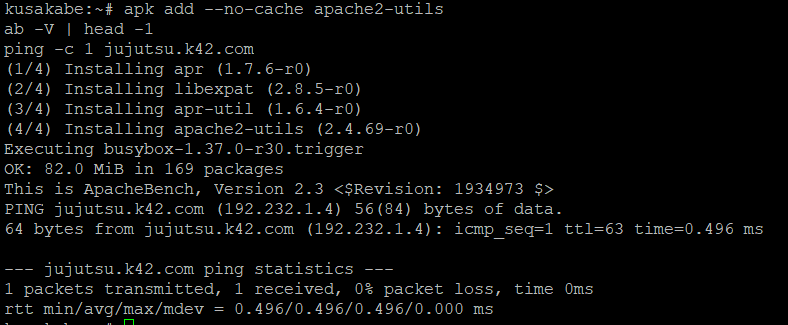

Sekarang Kusakabe siap untuk mulai dikerjakan, maka kita langsung saja masuk.

### Gojo
Kita pertama membuat access log pada gojo untuk membedakan kegagalan aplikasi, koneksi, dan request yang ditolak oleh kebijakan rate limit.

Pertama, kita memberi penanda log pada Gojo sebelum memulai benchmarking:
```
./soal20_gojo.sh mark
```

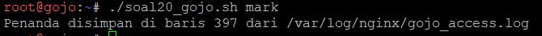

Mark sudah dibuat, sekarang kita masuk ke kusakabe.

### Benchmarking A
Lalu kita jalankan `soal20_kusakabe.sh` dengan:

Di Kusakabe:
```
./soal20_kusakabe web baseline
```

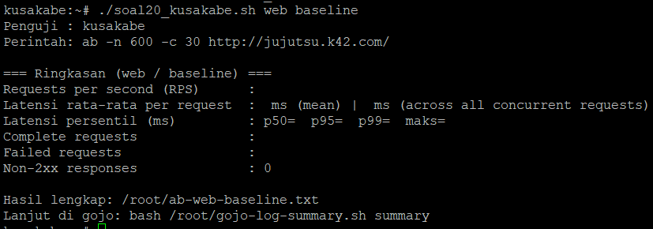

Script berhasil berjalan, berikut kita perlu untuk lanjut di gojo.

Di Gojo:
```
./soal20_gojo.sh summary
```

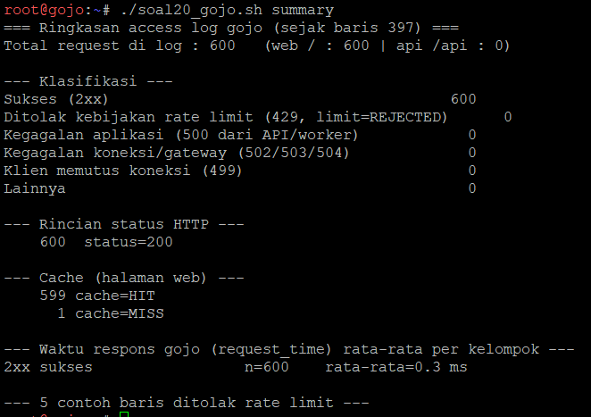

Disini terlihat bahwa ringkasan log gojo berhasil terlihat hasil dari ./soal20_kusakabe web baseline yang tercatat ke dalam summarynya.

### Benchmarking B
Sekarang kita lakukan benchmarking tanpa rate limiting pada baseline.

Di Gojo, kita jalankan berikut untuk mematikan rate-limiting dan membuat mark baru:
```
RATE_LIMIT=off ./script_gojo.sh 19
./soal20_gojo.sh mark
```

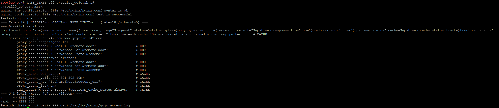

Disini terlihat rate-limiting berhasil dimatikan dan berhasil terbuatnya mark baru.

Di Kusakabe:
```
./soal20_kusakabe.sh api tanpa-limit
```

Jalankan berikut untuk menjalankan script api tanpa limitnya.

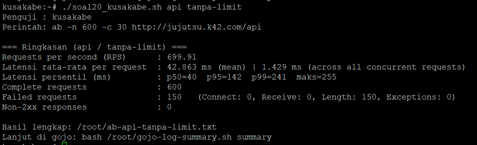

Script berhasil berjalan, lalu kita pantau summary dari gojo.
```
./soal20_gojo.sh summary
```

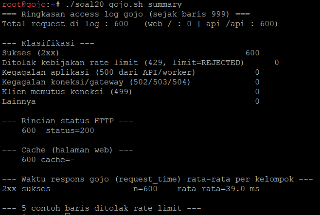

Disini terlihat bahwa tanpa rate-limiting, semua request berhasil diterima dengan waktu yang pendek.

### Benchmarking C
Sekarang kita lakukan benchmarking dengan rate limiting.

Di Gojo:
```
./script_gojo.sh 19
./soal20_gojo.sh mark
```

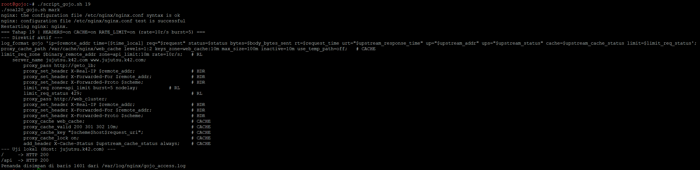

Disini terlihat rate-limiting sekarang hidup, lanjut.

Di Kusakabe:
```
./soal20_kusakabe.sh api dengan-limit
```

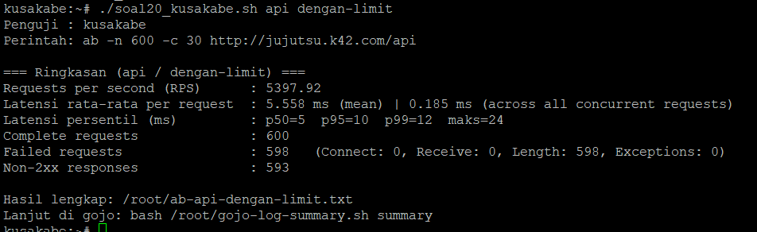

Dan terakhir kita pantau summary dari gojo lagi.
```
./soal20_gojo.sh summary
```

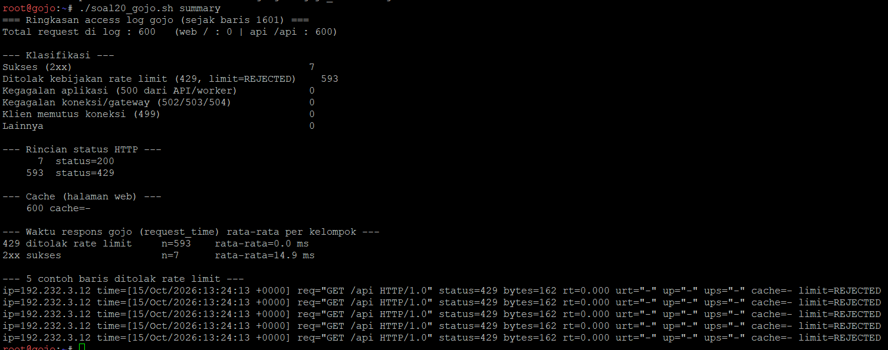

Disini terlihat bahwa dari 600 request yang dikirim, hanya 7 saja yang diterima dikarenakan rate-limiting.

### Perbandingan Hasil
Untuk membandingkan semua hasilnya, kita jalankan berikut.

Di Kusakabe:
```
./soal20_kusakabe.sh summary
```

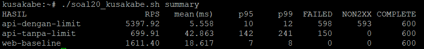

Sekarang kita bisa melihat hasil summary keseluruhan dari semuanya, mulai dari web-baseline, api-tanpa-limit, dan api-dengan-limit.

Berdasarkan hasil benchmarking, web baseline mampu menangani 600 request dengan RPS 1.611,40 tanpa request gagal. Pada endpoint API, kondisi tanpa rate limiting menghasilkan RPS 699,91 dengan latensi rata-rata 42,863 ms dan 150 request gagal, sedangkan saat rate limiting aktif, RPS meningkat menjadi 5.397,92 dengan latensi rata-rata 5,558 ms, tetapi terdapat 598 failed requests dan 593 respons non-2xx. Hal ini menunjukkan bahwa rate limiting membatasi banyaknya request yang diproses dan membuat respons terhadap request yang diterima lebih cepat, tetapi angka RPS yang tinggi tidak berarti seluruh request berhasil. Hasil ini perlu dianalisis bersama access log Gojo untuk memastikan apakah request gagal tersebut memang ditolak dengan HTTP 429 atau disebabkan oleh faktor lain.

Dengan ini, soal 20 selesai.